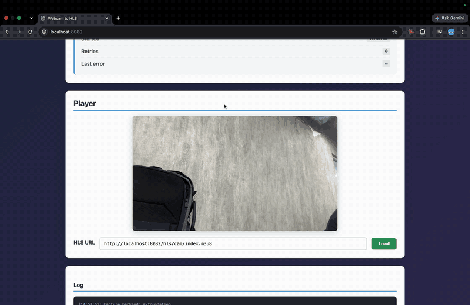

# Webcam → RTMP → HLS

[](https://github.com/venkateshmurukuri/Live-video-streaming/actions/workflows/ci.yml)
[](LICENSE)

A small, honest live-streaming chain: FFmpeg grabs a webcam, encodes H.264/AAC and pushes it over RTMP to
nginx-rtmp, which packages it as HLS for an hls.js player in the browser. A Spring Boot service supervises
the FFmpeg process, relaunches it with bounded exponential backoff when it dies, and exposes a REST API
and a one-page UI to drive it.

It runs on macOS, Linux and Windows, and has a `test` source so you can try it without a camera.

<!--  -->

## Architecture

```
                 host                                      docker
 ┌─────────────────────────────────────┐        ┌──────────────────────────┐
 │  Spring Boot  (:8080)               │        │  nginx-rtmp              │
 │  ┌─────────────┐  ┌──────────────┐  │  RTMP  │  :1935  ingest           │
 │  │ REST API    │─▶│ StreamManager│──┼────────┼─▶ H.264/AAC in FLV       │
 │  │ + static UI │  │ (supervisor) │  │        │     │                    │
 │  └─────────────┘  └──────┬───────┘  │        │     ▼  2 s fragments     │
 │                          │ spawns   │        │  /tmp/hls/<name>/*.ts    │
 │                   ┌──────▼───────┐  │        │  :80 → host :8082        │
 │   webcam ────────▶│   ffmpeg     │  │        └───────────┬──────────────┘
 │   (or testsrc)    └──────────────┘  │                    │ HTTP (HLS)
 └─────────────────────────────────────┘                    ▼
                                                   browser: hls.js player
```

The app has to run on the host because a container cannot see your webcam. nginx-rtmp runs in Docker.
The `demo` compose profile runs both in Docker using the synthetic source instead of a camera.

## Quick start

Prerequisites: Java 21, FFmpeg on `PATH` (or `FFMPEG_PATH`), Docker.

```bash
# macOS / Linux
./run.sh

# Windows (PowerShell)
.\run.ps1
```

Then open <http://localhost:8080>. The device field is pre-filled with a sensible default for your OS;
type `test` instead to stream a generated pattern. Click **Start stream**: the player attaches itself as soon as
nginx publishes the first playlist, a few seconds later.

No webcam, or just want to see it work?

```bash
docker compose --profile demo up --build
```

### Finding your camera's name

| OS      | Command                                               | Device value looks like   |
|---------|-------------------------------------------------------|---------------------------|
| macOS   | `ffmpeg -f avfoundation -list_devices true -i ""`     | `0` or `FaceTime HD Camera` |
| Linux   | `v4l2-ctl --list-devices`                             | `/dev/video0`             |
| Windows | `ffmpeg -list_devices true -f dshow -i dummy`         | `Integrated Camera`       |

## How it works

**Capture and encode.** `FFmpegCommandBuilder` assembles the argument list (a list, not a shell string, so
device names with spaces are safe) and picks the input device per OS: `avfoundation`, `v4l2` or `dshow`,
or `lavfi testsrc2` for `test`. The encode is tuned for live:

```
-c:v libx264 -preset veryfast -tune zerolatency -g 60 -keyint_min 60 -sc_threshold 0
-b:v 2000k -maxrate 2000k -bufsize 4000k -c:a aac -b:a 128k -f flv rtmp://…
```

The GOP is pinned to 2 s with scene-cut detection off, so every HLS fragment nginx cuts starts on a
keyframe. A silent AAC track is muxed in because some RTMP servers and players stall on video-only streams.

**Supervision.** `StreamManager` runs one thread per stream that launches FFmpeg, drains its output, and
waits for it to exit. If it exits while the stream is still wanted, it is relaunched after
1 s, 2 s, 4 s, 8 s, 15 s; after five consecutive failures the stream is marked `FAILED`. A run longer
than 30 s counts as healthy and resets that budget, so a flaky network hours in does not inherit old
failures. Stop sends SIGTERM, lets FFmpeg flush and close the RTMP connection, and escalates to SIGKILL
after 5 s. All of this is driven by `RetryPolicy`, which is pure and unit-tested.

**Packaging.** nginx-rtmp writes 2 s fragments and a 12 s playlist into `/tmp/hls/<stream>/`, served on
port 8082 with CORS enabled because the player page comes from port 8080.

**Playback.** The UI polls `GET /api/streams/{id}` and, once the stream is `RUNNING`, waits for the
playlist to appear with `HEAD` requests before attaching hls.js, so you never see a "manifest not found"
error during startup. hls.js is set to sit two fragments behind the live edge.

**Latency.** With 2 s fragments and a two-fragment buffer expect roughly 5–8 s glass-to-glass. This is
plain HLS, not LL-HLS; getting under 2 s would mean partial segments or a different protocol (see
[Limitations](#limitations)).

## API

| Method   | Path                  | Purpose                                            |
|----------|-----------------------|----------------------------------------------------|
| `GET`    | `/api/capture`        | Detected backend, default device, default destination |
| `POST`   | `/api/streams`        | Start a stream; body `{ "device", "destination" }` |
| `GET`    | `/api/streams`        | List streams                                       |
| `GET`    | `/api/streams/{id}`   | State, retry count, last error                     |
| `DELETE` | `/api/streams/{id}`   | Stop a stream (idempotent)                         |

```bash
curl -s -X POST localhost:8080/api/streams \
  -H 'Content-Type: application/json' \
  -d '{"device":"test","destination":"rtmp://localhost:1935/hls/cam"}'
# {"id":"8a1f…","device":"test","destination":"rtmp://localhost:1935/hls/cam","state":"STARTING","retryCount":0,…}

curl -s localhost:8080/api/streams/8a1f…
# {"state":"RUNNING",…}

# play it
ffplay http://localhost:8082/hls/cam/index.m3u8
```

Errors come back as RFC 9457 problem details, e.g. `400 {"detail":"destination: destination must look like rtmp://host[:port]/app/stream"}`.

## Configuration

All settings live in `application.properties` and can be overridden with environment variables.

| Variable              | Default                          | Meaning                                              |
|-----------------------|----------------------------------|------------------------------------------------------|
| `FFMPEG_PATH`         | `ffmpeg`                         | FFmpeg binary; a bare name is resolved on `PATH`     |
| `CAPTURE_FORMAT`      | `auto`                           | `auto`, `avfoundation`, `v4l2`, `dshow` or `test`    |
| `DEFAULT_DESTINATION` | `rtmp://localhost:1935/hls/cam`  | RTMP URL pre-filled in the UI                        |
| `PORT`                | `8080`                           | HTTP port of the app                                 |

Frame rate, resolution, bitrate and the retry schedule are `stream.*` properties in the same file.

## Tests

```bash
./mvnw test
```

- `FFmpegCommandBuilderTest`, `CaptureBackendTest`: the exact arguments per OS, device names with spaces, the `test` source.
- `RetryPolicyTest`: backoff schedule, cap, overflow safety, retry budget.
- `StreamManagerTest`: the supervisor against tiny shell scripts standing in for FFmpeg: relaunch-until-failed,
  stop kills the process promptly, stop during backoff does not wait out the delay, a stable run resets the budget.
- `StreamControllerTest`: HTTP contract with `@WebMvcTest`: 201/400/404 and problem-detail bodies.

## Project layout

```
src/main/java/com/video/stream/webcam/
├── api/        StreamController, ApiExceptionHandler, DTOs
├── capture/    CaptureBackend (per-OS input), FFmpegCommandBuilder, ProcessLauncher, startup check
├── config/     StreamProperties (stream.*), executor / launcher / retry-policy beans
└── stream/     StreamManager (supervisor), StreamSession, RetryPolicy, StreamState
src/main/resources/static/   index.html, player.js (hls.js), player.css
nginx.conf                   nginx-rtmp: RTMP ingest → HLS
docker-compose.yml           nginx-rtmp, plus the `demo` profile (app + FFmpeg in a container)
```

## Limitations

This is a single-process demo, and it says so:

- Stream state is in memory; restart the app and it forgets its streams (FFmpeg children are stopped on shutdown).
- No authentication on the API or on RTMP publish (`allow publish all` in `nginx.conf`).
- One encode ladder, no ABR; one stream per FFmpeg process, no GPU.
- Plain HLS at 5–8 s latency. Next steps if this were to grow: SRT ingest instead of RTMP, LL-HLS or WebRTC for
  sub-second playback, an ABR ladder, Prometheus metrics from the supervisor, and persisted stream state.

## License

[MIT](LICENSE)
